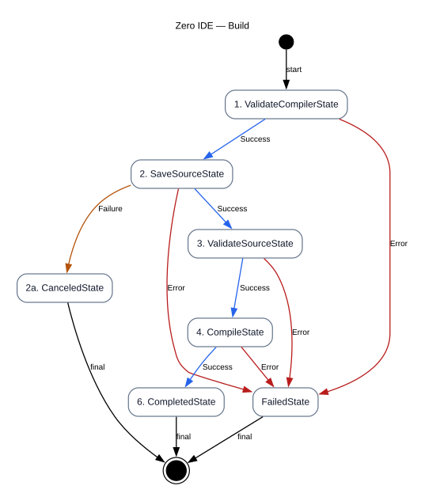
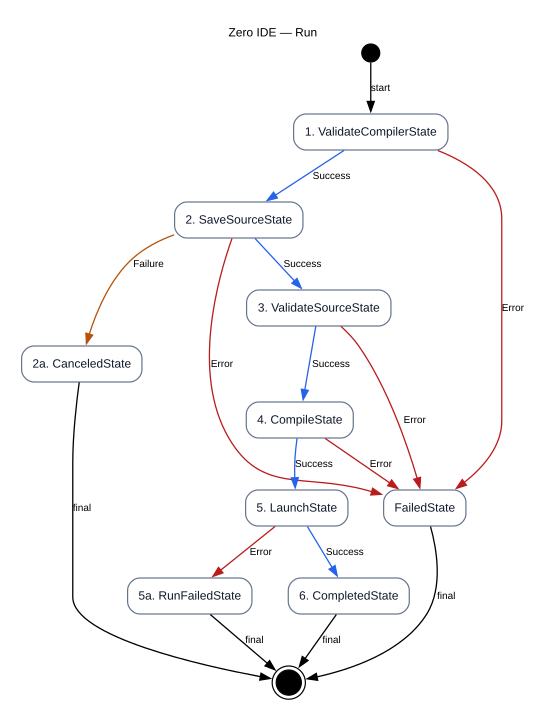

# IDE execution state diagrams

These diagrams are generated by Lite.StateMachine's `ExportUml` method from the
same registered transitions used by `EditorExecutionCoordinator`. They describe
build and launch orchestration, not the native debugger's running/paused states.

State labels use the class names; normal steps and cancellation/run-failure
branches carry the execution numbering from the XML comments.
Blue **Success** edges continue the workflow. Red **Error** edges report a
failure. The amber **Failure** edge from `SaveSourceState` means the user
canceled saving; no compilation or launch follows. Black circles mark entry and
terminal exits. Each request ends at one terminal state; terminals do not execute
in sequence.

## Build only

Successful compilation goes straight to `CompletedState`, skipping step 5.
The clean-and-build option is handled within `CompileState`.



[Graphviz DOT source](images/ide-execution/build.dot)

## Build and run without debugging

After compilation, `LaunchState` starts the program. Launch errors lead to
`RunFailedState`, retaining successful compiler diagnostics.



[Graphviz DOT source](images/ide-execution/run.dot)

## Build and start debugging

Debug startup always uses the Debug configuration. `LaunchState` starts the
debugger; startup errors lead to `FailedState`. After startup completes, the
separate `IDebugSession` owns execution, pause, step, and stop state.


[Graphviz DOT source](images/ide-execution/debug.dot)

`Built` is a progress notification emitted inside `CompileState`, not a separate
registered state, so it does not appear as a node.

## Event notifications

The singleton `IIdeEventService` uses Lite.EventIPC for local notifications.
It publishes these immutable records from `Zero.Ide.Events`:

| Event | Published when |
| --- | --- |
| `ExecutionStateChangedEvent` | A workflow stage is entered, including the `Built` progress notification and terminal outcomes. |
| `BuildStartedEvent` | Validation and saving succeeded and the compiler is about to run. |
| `BuildCompletedEvent` | A compiler attempt finishes, fails, or throws, before launching the output. |
| `WorkspaceOpenedEvent` | A folder is selected and its explorer root is initialized; children load lazily. |
| `DebugStoppedEvent` | Debugging pauses at entry, a breakpoint, a step, or an exception; includes a copied register snapshot. |
| `DebugSessionEndedEvent` | A debug session exits or faults. |

All events include a UTC `Timestamp`. Execution and build notifications share an
`ExecutionId`, source path, mode, and configuration. A canceled save or validation
failure has a terminal state notification but no compiler-attempt events.
`BuildCompletedEvent.Succeeded` describes compilation; a later launch can still
fail. Native debugger notifications come from `IDebugSession`, which owns the
running/paused lifecycle after the build workflow finishes.

Inject `IIdeEventService` into subscribers and retain the subscription token:

```csharp
IDisposable subscription = events.Subscribe<BuildCompletedEvent>(notification =>
{
  Dispatcher.UIThread.Post(() =>
    Status = notification.Succeeded ? "Build succeeded" : "Build failed");
});

// When the subscriber is closed or unloaded:
subscription.Dispose();
```

Handlers run in the background and must marshal UI work onto Avalonia's
dispatcher. An overload accepts `Func<TEvent, Task>` for asynchronous handlers;
use that overload instead of `async void`. Exceptions are traced and isolated.
Delivery is ordered within each subscription, with no ordering guarantee across
event types or subscriptions. Use `ExecutionId` to correlate build notifications.

These are best-effort observational signals. Each subscription has a bounded
256-event queue that drops its oldest pending item when full. A blocked or slow
subscriber therefore cannot stall the UI, state machine, or another subscriber,
and pending events cannot consume unbounded memory. Disposing a token detaches
it and stops queued delivery; an already executing handler may finish afterward.
Application shutdown disposes the hub without waiting for handlers. Use direct
service calls for commands or operations that require guaranteed completion.
This registers local delivery only; no named-pipe or network endpoint is opened.

## Regenerating

From the repository root, export all three DOT files without executing the
workflow, saving documents, invoking a compiler, or starting a debugger:

```powershell
dotnet run --project source/Zero.Ide.Diagrams/Zero.Ide.Diagrams.csproj -c Release -- docs/images/ide-execution
```

Render the DOT files with a local Graphviz installation, for example:

```powershell
dot -Tsvg docs/images/ide-execution/run.dot -o docs/images/ide-execution/run.svg
```

To reproduce the committed SVG styling without a system Graphviz installation,
use the optional Graphviz WebAssembly renderer (requires Node.js and npm):

```powershell
npm install --prefix output/ide-diagram-tools --no-save --ignore-scripts --no-audit --no-fund @viz-js/viz@3.31.0
node source/Zero.Ide.Diagrams/render.mjs output/ide-diagram-tools/node_modules/@viz-js/viz/dist/viz.js docs/images/ide-execution
```

The renderer changes presentation only. State names, edges, and transition
results come directly from Lite.StateMachine's exported DOT.
