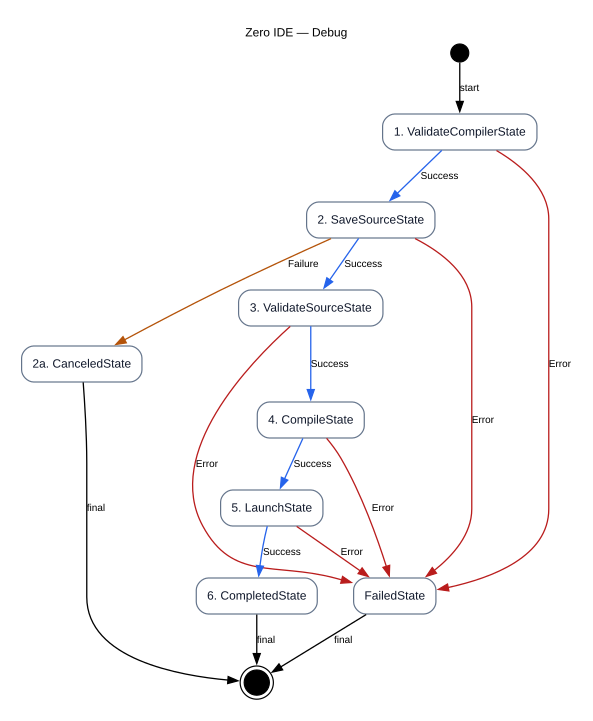

# IDE execution state diagrams

These diagrams are generated by Lite.StateMachine's `ExportUml` method from the
same registered transitions used by `EditorExecutionCoordinator`. They describe
build and launch orchestration, not the native debugger's running/paused states.

State labels use the class names; normal steps and cancellation/run-failure
branches carry the execution numbering from the XML comments.
Blue **Success** edges continue the workflow. Red **Error** edges report a
failure. The amber **Failure** edge from `SaveSourceState` means the user
canceled saving; no compilation or launch follows. Black circles mark entry and
terminal exits. Each request ends at one terminal state; terminals do not execute
in sequence.

## Build only

Successful compilation goes straight to `CompletedState`, skipping step 5.
The clean-and-build option is handled within `CompileState`.


[Graphviz DOT source](images/ide-execution/build.dot)

## Build and run without debugging

After compilation, `LaunchState` starts the program. Launch errors lead to
`RunFailedState`, retaining successful compiler diagnostics.


[Graphviz DOT source](images/ide-execution/run.dot)

## Build and start debugging

Debug startup always uses the Debug configuration. `LaunchState` starts the
debugger; startup errors lead to `FailedState`. After startup completes, the
separate `IDebugSession` owns execution, pause, step, and stop state.



[Graphviz DOT source](images/ide-execution/debug.dot)

`Built` is a progress notification emitted inside `CompileState`, not a separate
registered state, so it does not appear as a node.

## Regenerating

From the repository root, export all three DOT files without executing the
workflow, saving documents, invoking a compiler, or starting a debugger:

```powershell
dotnet run --project source/Zero.Ide.Diagrams/Zero.Ide.Diagrams.csproj -c Release -- docs/images/ide-execution
```

Render the DOT files with a local Graphviz installation, for example:

```powershell
dot -Tsvg docs/images/ide-execution/run.dot -o docs/images/ide-execution/run.svg
```

To reproduce the committed SVG styling without a system Graphviz installation,
use the optional Graphviz WebAssembly renderer (requires Node.js and npm):

```powershell
npm install --prefix output/ide-diagram-tools --no-save --ignore-scripts --no-audit --no-fund @viz-js/viz@3.31.0
node source/Zero.Ide.Diagrams/render.mjs output/ide-diagram-tools/node_modules/@viz-js/viz/dist/viz.js docs/images/ide-execution
```

The renderer changes presentation only. State names, edges, and transition
results come directly from Lite.StateMachine's exported DOT.
